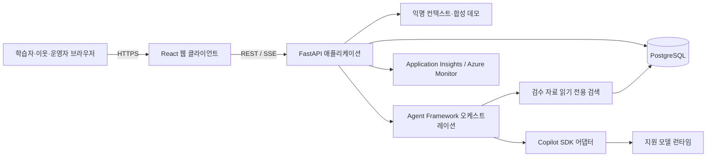
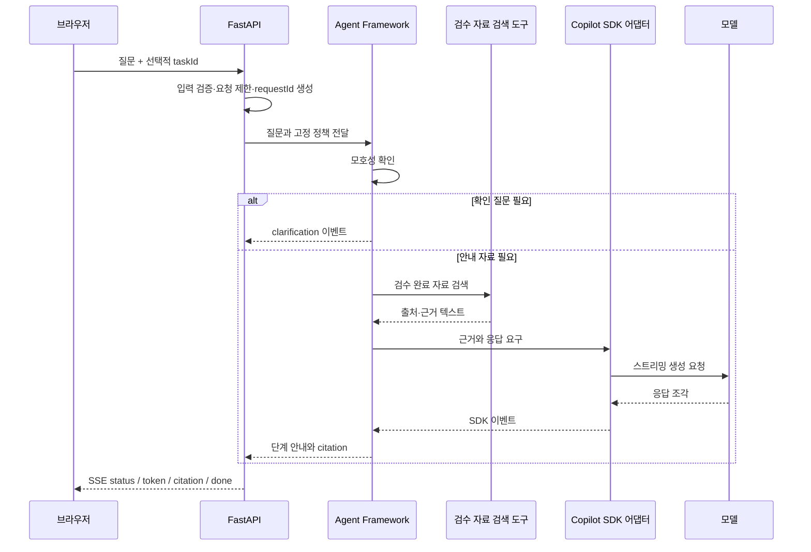

# 청도 디지털 생활도우미 — 기술 설계 문서

| 항목 | 내용 |
|---|---|
| 문서 상태 | TRD 기반 상세 기술 설계안 |
| 기준 문서 | [`PRD.md`](PRD.md), [`TRD.md`](TRD.md) |
| 설계 대상 | 반응형 웹, 공개 합성 데모, 학습 기록, AI 생활 코치, 동네 학습모임 |
| 핵심 결정 | 단일 웹/API 애플리케이션, 익명 공개 접근, 검수 자료 기반 AI, 합성 데모 데이터 격리 |

> **이 문서의 목적:** PRD가 정의한 제품 요구사항을 TRD가 기술 구성과 계약으로 정리했다면, 이 TDD(Technical Design Document)는 각 설계가 필요한 이유와 구성요소 사이의 책임·흐름을 설명한다. 애플리케이션은 아직 구현되지 않았으므로 이 문서는 구현 기준안이며, SDK 런타임과 클라우드 배포 방식 등 명시된 결정 게이트는 실제 구현 전에 검증해야 한다. 이 문서는 테스트 계획서가 아니다.

## 1. 설계 목표와 제약

### 1.1 해결할 설계 문제

서비스는 스마트폰 사용이 익숙하지 않은 어르신이 과제를 직접 익히도록 도와야 한다. 안내는 부담 없이 따라 할 수 있어야 하며, AI가 해결하지 못한 질문은 지역 이웃의 도움으로 이어져야 한다. 동시에 공개 심사자는 로그인이나 별도 권한을 준비하지 않고 핵심 기능을 즉시 사용해야 한다.

이 요구를 한 시스템 안에서 만족시키기 위해 다음 원칙을 우선한다.

1. **진입보다 학습을 먼저:** 홈과 핵심 기능을 공개하고, 페르소나나 익명 식별자를 접근 통제 수단으로 사용하지 않는다.
2. **안내와 실행을 분리:** AI는 설명과 검색만 하고 메시지 발송, 예약, 결제, 게시 등 사용자를 대신하는 행동은 하지 않는다.
3. **작게 나누되 배포는 단순하게:** 내부 모듈의 책임은 분리하되, 초기부터 마이크로서비스 운영 부담을 도입하지 않는다.
4. **원본 상태를 명확히:** 과제 완료와 게시물 상태를 원본으로 보존하고, 배지·집계는 이 상태에서 다시 계산할 수 있게 한다.
5. **합성 데모를 안전 경계로:** 공개된 쓰기·운영 흐름은 합성 데모에 한정하고 실제 사용자 데이터와 분리한다.
6. **오류를 회복 가능한 상태로:** 네트워크·검색·모델 실패 시 사용자가 멈추거나 다시 시도하고 사람에게 도움을 요청할 수 있게 한다.

### 1.2 설계 범위와 제외

이 설계는 브라우저 UI, 애플리케이션/API, AI 오케스트레이션, 관계형 저장소, Azure 배포를 다룬다. 실제 기기를 원격 조작하거나 외부 생활 서비스를 대신 실행하는 기능, 실제 군민 계정/데이터 운영, 공개 전국 SNS, 1:1 실시간 채팅은 범위에 포함하지 않는다.

## 2. 핵심 설계 결정과 근거

| 결정 | 설계 | 선택 이유 | 비용·대안 및 상태 |
|---|---|---|---|
| 웹 클라이언트 | React + TypeScript + Vite | 과제 단계, 커뮤니티 목록, AI 응답 상태를 컴포넌트 단위로 표현하고 정적 자산으로 제공하기 쉽다. | 초기에는 별도 상태관리 프레임워크 없이 시작한다. 기술 선택은 구현팀 확정 대상이다. |
| API 런타임 | Python 3.12 + FastAPI | 비동기 API와 SSE를 지원하고 Microsoft Agent Framework의 Python 흐름과 같은 런타임에 둘 수 있다. | 팀의 배포 환경과 SDK 호환성 확인이 필요하다. |
| 에이전트와 모델 연결 | Agent Framework가 흐름·도구를 조정하고 Copilot SDK 어댑터가 모델 연결을 담당 | 오케스트레이션, 검색, 모델 통신을 분리하면 공급자/SDK 세부사항이 도메인 로직에 번지는 것을 줄인다. | SDK/CLI 실행, 비대화형 인증, Container Apps 지원 여부를 사전 spike로 확인한다. |
| 애플리케이션 형태 | 웹 정적 파일과 API를 한 애플리케이션으로 배포하는 모듈러 모놀리스 | 초기 팀 규모에서 네트워크 경계와 배포 파이프라인을 줄이고, 같은 오리진으로 CORS 복잡성을 피한다. | AI 동시성이나 팀 소유 경계가 커지면 나중에 분리한다. 지금 마이크로서비스를 도입하지 않는다. |
| 서버 이벤트 전송 | 코치 응답은 SSE, 나머지 데이터 변경은 REST | 코치가 서버에서 브라우저로 보내는 단방향 진행 이벤트에 맞고, 일반 CRUD 계약을 단순하게 유지한다. | 양방향 실시간 채팅이나 협업 편집이 필요해지면 WebSocket을 재검토한다. |
| 영속 데이터 | PostgreSQL 관계형 모델 | 과제 완료, 배지 고유성, 게시물 상태처럼 제약과 트랜잭션이 중요한 데이터를 일관되게 관리한다. | 정식 Azure 서비스와 네트워크 구성은 구독·비용 확인 후 확정한다. |
| 심사자 접근 | 로그인 없는 공개 합성 데모 | 별도 계정·초대·권한 승인이 평가를 막지 않도록 한다. | 이는 실사용자 운영 모드가 아니다. 공개 API의 쓰기·숨김 기능은 합성 데이터만 변경한다. |
| 익명 연속성 | 선택적 익명 visitor ID | 로그인 없이 과제 이어하기와 중복 집계를 가능하게 한다. | 인증·신원 증명으로 취급하지 않으며, 쿠키가 없어도 기본 기능을 제공한다. |
| 안내 검색 | 검수 완료 문서만 검색하는 읽기 전용 도구 | 생활 정보에서 그럴듯하지만 틀린 안내를 줄이고, 답변의 출처를 제시한다. | 검색 품질이 요구 수준에 못 미치면 문서 구조와 검색 전략을 개선한다. MVP에 별도 벡터 검색 서비스를 먼저 추가하지 않는다. |
| 클라우드 구성 | Container Apps, PostgreSQL, Application Insights/Azure Monitor 중심 | 웹/API, 영속 상태, 운영 관찰이라는 필수 요구에 맞춘 최소 구성이다. | 실제 리소스 수와 네트워크는 비용·구독 제약에 따라 조정한다. 미사용 Azure 서비스를 형식적으로 추가하지 않는다. |

## 3. 시스템 구조와 책임 경계



### 3.1 웹 클라이언트

클라이언트는 홈, 과제 목록과 단계, 코치 대화, 모임 게시물, 운영 시연, 집계 화면을 제공한다. 화면 상태는 서버의 API 응답을 기준으로 갱신한다. 로딩·빈 목록·오류·재시도 상태를 별도 UI로 제공해 사용자가 실패를 성공으로 오해하지 않게 한다.

화면의 `learner`, `volunteer`, `moderator` 페르소나는 데모 흐름과 예시 라벨을 바꾸는 프레젠테이션 상태다. 서버의 인가 정책으로 전달하지 않는다. 따라서 운영자 화면을 보여주는 페르소나 선택은 심사 체험을 위한 것이며, 실제 데이터의 운영 권한 모델이 아니다.

### 3.2 애플리케이션/API

FastAPI 계층은 HTTP 계약, 입력 검증, 익명 데모 컨텍스트, 응답 직렬화와 오류 표준화를 담당한다. 비즈니스 규칙은 라우트 함수에 집중시키지 않고 다음 도메인 모듈에 둔다.

- `learning`: 검수된 과제 조회, 단계 진행, 완료 저장
- `community`: 모임 게시물·답변·해결·신고·숨김 상태
- `progress`: 개인 배지와 모임 공동 진척 계산
- `coach`: 에이전트 오케스트레이션, 검색 도구, SDK 어댑터, SSE 변환
- `demo`: 공개 합성 워크스페이스, 익명 식별자와 재설정
- `content`: 검수 과제와 안내 문서
- `telemetry`: 요청 ID, 오류·지연 관찰 및 민감 데이터 제외

이 경계는 같은 프로세스 안에서 코드와 의존성을 분리한다. 각 모듈이 독립 서비스인 것처럼 네트워크 호출을 강제하지 않아 로컬 실행과 첫 배포를 단순하게 유지한다.

### 3.3 저장소와 외부 의존성

PostgreSQL은 도메인 상태와 검수 콘텐츠의 원본 저장소다. 검색·모델은 애플리케이션이 호출하는 외부 의존성이고, 브라우저는 이들 서비스에 직접 연결하지 않는다. 따라서 자격 증명과 검색 범위는 서버에서 통제하고, 외부 서비스 장애는 표준 애플리케이션 오류 흐름으로 변환한다.

## 4. 데이터 설계와 일관성

### 4.1 원본 데이터와 파생 데이터

다음 항목은 상태 변경의 원본이다.

- `learning_tasks`, `task_steps`: 검수된 학습 콘텐츠
- `learning_progress`: 익명 방문자별 과제 시작·완료 기록
- `posts`, `answers`, `reports`: 커뮤니티 작성 내용과 현재 상태
- `guide_documents`: 출처와 검수 상태를 포함한 AI 검색 자료

`user_badges`, 대시보드 지표, 모임 이정표는 원본 상태에서 계산되는 결과다. 배지 발급과 집계가 중복되거나 오래된 상태로 남지 않도록 고유 제약과 트랜잭션을 우선하고, 캐시를 도입하더라도 재계산 가능한 파생 값으로 취급한다.

### 4.2 익명 식별자와 개인정보 경계

`demo_visitors`의 visitor ID는 과제 진행 연속성과 합성 데이터 귀속에 쓰는 임의 식별자다. 계정이 아니며 이름·이메일·전화번호와 연결하지 않는다. 서명 쿠키를 제공할 수 있지만 이를 인증 토큰으로 쓰지 않는다. 쿠키가 없는 요청은 임시 컨텍스트로 수행하며 접근 권한을 거부하지 않는다.

익명 ID와 페르소나는 조작·초기화될 수 있다. 그러므로 개인 배지는 데모 UI에서 현재 컨텍스트에 보여주는 표시일 뿐 신원 확인이나 접근 제어를 제공하지 않는다. 익명 참여자 수를 이용한 모임 진척도 데모 시각화이며 실제 주민 수나 생산성 지표로 해석하지 않는다.

### 4.3 제약 및 재계산 규칙

- `(visitor_id, task_id)` 고유 진행 기록을 사용해 같은 과제 재시도가 완료 과제 수를 늘리지 않게 한다.
- `(visitor_id, badge_id)` 고유 제약으로 같은 배지의 중복 발급을 막는다.
- 모임 공동 해결 건수는 현재 해결 상태인 도움 요청 게시물의 고유 ID를 기준으로 계산한다. 질문, 미해결, 숨김 게시물은 제외한다.
- 모임 진척은 적격 게시물에 참여한 서로 다른 익명 ID가 3명 이상일 때만 표시한다. 개인 기여자 목록이나 모임 간 순위는 제공하지 않는다.
- 상태 변경과 파생 집계 무효화는 원본 변경과 일관되게 처리한다. 캐시가 실패해도 원본 상태가 진실의 원천이다.

## 5. 핵심 처리 흐름

### 5.1 공개 데모 진입

1. 브라우저가 공개 URL을 열고 정적 앱을 불러온다. 로그인·회원가입·초대·승인 화면은 거치지 않는다.
2. 클라이언트가 데모 컨텍스트를 조회한다. 익명 쿠키가 있으면 이어하기에 선택적으로 활용하고, 없으면 임시 컨텍스트를 발급하거나 요청 단위로 처리한다.
3. 사용자는 언제든 페르소나와 모임을 선택한다. 이 선택은 화면 흐름과 합성 활동 귀속에만 사용한다.
4. 모든 핵심 API는 방문자 인증 없이 동작하며, 실제 사용자 데이터가 아닌 격리된 데모 데이터만 읽고 쓴다.

공개 상태 변경을 허용하는 대신 데이터 경계를 보안의 핵심으로 삼는다. 따라서 공개 API를 운영 데이터베이스나 실제 주민 커뮤니티에 연결하는 구성은 허용하지 않는다.

### 5.2 과제 학습과 진척

1. 클라이언트는 검수 완료 과제와 단계를 조회한다.
2. 사용자가 과제를 시작하거나 단계를 이동하면 진행 API가 익명 데모 컨텍스트에 상태를 저장한다.
3. 완료 요청은 같은 과제의 기존 진행 레코드를 갱신하며 새 완료를 중복 생성하지 않는다.
4. 개인 배지는 고유 완료 과제 수를 기준으로 계산하고, 화면 표시 설정은 장식/배지의 노출만 조정한다.
5. 표시를 끄더라도 단계 안내, 이어하기, 완료 상태 및 커뮤니티 기능은 계속 사용할 수 있다.

### 5.3 AI 코치와 검색 근거



구성요소의 책임은 다음과 같다.

1. **API:** 공개 요청 검증, 동시성·요청 제한, `requestId` 생성, 안정된 SSE 형식 제공.
2. **Agent Framework:** 확인 질문 여부, 검색 도구 호출 순서, 답변 구성 규칙을 조정.
3. **검색 도구:** `review_status=approved`인 안내 문서만 읽고 문서 식별자·제목·출처·필요 최소 근거를 반환.
4. **Copilot SDK 어댑터:** 선택한 SDK의 모델 연결과 스트리밍 이벤트를 앱 내부 인터페이스로 변환.
5. **브라우저:** 답변을 AI 생성 결과로 표시하고, 중단·재시도·사람 도움 요청을 제공. 답변을 게시할 때는 사용자가 별도로 확인한다.

SDK의 실제 이벤트 형식은 앱 내부 계약에 노출하지 않는다. API는 `status`, `token`, `citation`, `clarification`, `done`, `error` 이벤트를 안정적으로 제공한다. 근거가 없거나 모델/검색이 실패하면 추측을 정상 답변처럼 반환하지 않고 사람 도움 또는 재시도 경로를 안내한다.

### 5.4 커뮤니티 도움 요청과 운영 시연

게시물 작성, 답변, 해결/재개, 신고, 숨김은 REST 상태 변경으로 처리한다. 해결 상태는 게시물 작성자가 완료 여부를 표시하기 위한 제품 흐름이며, 공개 데모에서는 사용자 인증이 없으므로 특정 사용자의 신원을 입증하지 않는다. 숨김 역시 공개 심사 환경의 합성 게시물에만 적용된다.

실제 운영 커뮤니티에는 인증 및 운영자 권한 확인이 필요할 수 있다. 이는 공개 데모 API를 재사용해 결정하지 않으며, 파일럿 시작 전에 별도 운영 모드와 접근 정책을 설계해야 한다.

### 5.5 데모 재설정

재설정 API는 seed 자료와 시연용 게시물 상태만 초기화한다. 실사용자 테이블 또는 운영 리소스에 대한 범용 삭제 기능으로 만들지 않는다. 요청 크기 제한, 호출 제한, Origin 확인은 자동 남용을 완화하지만 가입·로그인 장벽으로 변환하지 않는다.

## 6. API·오류·스트리밍 설계

### 6.1 REST와 DTO 경계

핵심 조회/상태 변경은 `/api/v1` 아래 REST JSON 계약을 사용한다. 웹 클라이언트 DTO와 ORM 엔티티를 분리해 저장 스키마 변경이 API 응답에 직접 전파되지 않게 한다. 서버는 경로 파라미터, 본문 크기, 필드 길이, enum, 페이지 크기를 검증한다.

심사 배포에서는 인증이 없다는 이유로 핵심 경로에서 `401` 또는 `403`을 반환하지 않는다. 입력 형식이 잘못되었거나 제한을 초과한 경우에만 적절한 `4xx`를 반환한다.

### 6.2 오류 모델

클라이언트에는 내부 예외와 stack trace 대신 공통 오류 객체를 반환한다.

```json
{
  "error": {
    "code": "invalid_request",
    "message": "입력 내용을 확인하고 다시 시도해 주세요.",
    "requestId": "server-generated-id"
  }
}
```

각 오류는 다음 행동을 설명해야 한다. 검증 오류는 수정 방법, `404`는 대상을 찾을 수 없다는 점, `409`는 현재 상태와 충돌했다는 점, `429`는 잠시 후 재시도 가능성, `502/503`은 사람 도움 또는 재시도를 제공한다. 오류 응답에는 SQL, 프롬프트, 토큰, 비밀 값이 포함되지 않는다.

### 6.3 SSE 계약

SSE는 브라우저에서 서버로의 연속적인 답변 스트림에만 사용한다. 생성 중단은 브라우저 연결 종료와 서버 취소 신호를 연결하며, SDK가 취소를 지원하지 않는 경우 서버 측 최대 처리 시간과 유휴 작업 종료 기준을 둔다. 토큰마다 화면 낭독을 발생시키지 않고 문장/단계 단위로 접근 가능한 상태를 갱신한다.

## 7. 보안·개인정보·남용 방지

### 7.1 공개 접근의 보안 모델

이 설계는 공개 데모 사용자를 신뢰하거나 역할 값으로 인가하지 않는다. 공개로 실행되는 쓰기·신고·숨김 API가 변경할 수 있는 대상을 합성 데모 데이터로 제한한다. 실제 서비스 데이터와 데모는 데이터베이스 또는 최소한 환경·자격 증명 수준에서 격리한다.

데모의 페르소나, 쿠키, visitor ID는 권한 증명이 아니다. 서버 비밀은 브라우저에 전달하지 않으며, Copilot SDK 자격 증명은 앱의 모델 호출에만 사용한다. 장기 개인 토큰을 코드, 이미지, 저장소에 넣는 방식은 허용하지 않는다.

### 7.2 입력 및 출력 경계

- 사용자가 실제 비밀번호, 인증번호, 결제·건강 정보, 전화번호 등을 입력하지 않도록 입력 주변에 안내한다.
- 커뮤니티 본문과 모델 출력을 신뢰하지 않는 텍스트로 취급하고 HTML을 escape한다. 링크는 안전한 URL 정책을 적용한다.
- 검색 문서와 질문은 지시문이 아닌 데이터로 취급한다. 검색 도구는 읽기 전용이고 검수된 문서만 제공한다.
- 에이전트에는 커뮤니티 작성/숨김, 메시지 전송, 결제 등 외부 side effect 도구를 등록하지 않는다.
- AI 질문·커뮤니티 원문, 쿠키, Authorization 헤더, secret은 기본 애플리케이션 로그와 관찰성 기록에 남기지 않는다.

### 7.3 남용 제한

공개 서비스의 비용·스팸 위험은 가입 장벽이 아니라 요청 제한과 합성 데이터 격리로 완화한다. 본문·요청 크기, 페이지 크기, AI 동시 실행 및 분당 요청을 제한하고, 반복 신고/재설정 요청도 제한한다. 모든 제한은 사용자에게 이해 가능한 재시도 상태를 제공하며 핵심 기능의 로그인 요구로 대체하지 않는다.

같은 오리진을 우선 사용하고 CORS를 와일드카드로 설정하지 않는다. 상태 변경 요청에는 적절한 Origin 검증을 적용하되, 쿠키나 로그인 없는 정상 공개 요청이 불필요하게 막히지 않도록 실제 브라우저 요청 흐름과 함께 설계한다.

## 8. 사용자 경험과 접근성 설계

어르신 사용자는 작은 화면, 익숙하지 않은 용어, 오류 복구의 어려움에 영향을 받는다. 그러므로 접근성은 시각적 마감이 아니라 화면 구조와 API 상태 설계에 포함한다.

- 한 화면에 핵심 행동 하나를 두고 쉬운 한국어와 구체적인 동사형 버튼을 쓴다.
- 단계형 과제에서 현재 위치, 이전 단계, 다음 행동을 텍스트와 시각 신호로 함께 나타낸다.
- 기본 글자를 확대할 수 있고 브라우저 줌을 막지 않는다. 색만으로 상태나 오류를 구분하지 않는다.
- 시맨틱 헤딩, 입력 레이블, 키보드 조작, 명확한 포커스, 충분한 터치 영역과 색 대비를 제공한다.
- 음성 읽기는 사용자가 시작·중지하며, 지원되지 않는 기기에서도 같은 안내를 텍스트로 이용한다.
- 로딩·빈 데이터·오류·요청 제한 상태는 현재 상황과 가능한 다음 행동을 설명한다.
- 진척 표시를 숨겨도 학습 기록과 과제 수행을 막지 않는다. 연속 접속, 실패 초기화, 시간 압박을 보상 조건으로 사용하지 않는다.

## 9. 배포·운영 설계

### 9.1 배포 토폴로지

- **Azure Container Apps:** React 정적 결과물과 FastAPI를 동일 오리진으로 제공하는 앱 컨테이너. 공개 심사 URL에는 로그인 프록시, 인증 provider, 초대 관문을 두지 않는다.
- **Azure Database for PostgreSQL Flexible Server:** 과제, 안내 자료, 진행, 합성 커뮤니티 상태를 저장한다. 네트워크 및 DB 사용자 권한은 가능한 최소 범위로 제한한다.
- **Application Insights/Azure Monitor:** 요청 ID, endpoint, 상태 코드, 지연, 외부 의존성 성공/실패를 관찰한다. 질문·게시물 원문은 기본 수집하지 않는다.
- **Container Apps secrets 또는 Key Vault 연동:** DB와 모델 연결 secret을 런타임에 주입한다. 빌드 로그·컨테이너 이미지·Git에 secret을 저장하지 않는다.

### 9.2 운영 상태

`/health/live`는 프로세스 생존, `/health/ready`는 앱 설정과 필수 DB 연결 준비를 나타낸다. readiness 응답은 비밀 값을 반환하지 않는다. 운영 지표는 HTTP 오류/지연, DB 실패, AI 지연·실패, 근거 없음, SSE 끊김/완료를 포함한다.

DB 마이그레이션은 호환성 있는 순서로 적용하고, 이전 컨테이너 이미지로 되돌릴 수 있게 릴리스 버전을 관리한다. 공개 데모의 DB와 시연 자료는 재설정 가능한 합성 상태로 유지한다. 실사용 파일럿 데이터는 별도 승인, 동의, 보관/삭제 정책과 격리 구성이 마련되기 전 이 배포에 연결하지 않는다.

## 10. 트레이드오프와 검토 대안

| 선택 | 얻는 점 | 감수하는 점 | 다시 검토할 조건 |
|---|---|---|---|
| 모듈러 모놀리스 | 로컬 실행·배포·관찰이 단순하고 세 명이 통합하기 쉽다. | 한 런타임에서 장애와 확장 경계가 공유된다. | AI 처리 부하가 일반 API를 지속적으로 방해하거나 독립 배포가 실제로 필요할 때 |
| PostgreSQL 기본 검색 | 데이터/운영 구조가 단순하고 검색 원문·출처를 함께 관리한다. | 대규모 의미 검색의 검색 품질이 낮을 수 있다. | 검수 자료가 커지고 검색 실패가 사용자 과제 해결을 막는다는 근거가 있을 때 |
| SSE | 단방향 모델 응답 스트리밍에 맞고 REST API와 함께 쓰기 쉽다. | 브라우저에서 서버로의 양방향 이벤트에는 적합하지 않다. | 동시 편집 또는 양방향 실시간 협업이 제품 요구가 될 때 |
| 공개 합성 데모 | 심사자가 장벽 없이 전 기능을 평가하고 공개 쓰기 위험을 가상 데이터로 제한한다. | 익명 활동 수치는 조작 가능하고 실제 파일럿 성과를 나타내지 않는다. | 실제 주민 대상 운영을 시작하기 전에 별도의 인증·권한·개인정보 설계가 승인될 때 |
| 서버 측 AI 호출 | SDK 자격 증명과 검색 정책을 브라우저에서 숨긴다. | 서버 운영 비용과 외부 모델 의존성이 생긴다. | 모델 제공자, 비용 한도, 데이터 처리 정책을 재검토해야 할 때 |

## 11. 구현 순서와 결정 게이트

다음 순서는 모듈의 실제 의존 관계를 기준으로 한다. UI와 API 계약은 초기에 함께 고정하고, AI 런타임은 후속 통합 전에 검증한다.

1. **계약·로컬 실행 기준 확정:** DTO, 오류 객체, 공개 데모 의미, 데이터 격리 원칙, 환경 변수 목록을 정한다.
2. **기본 애플리케이션과 저장소:** 정적 웹/API 배포, DB 스키마/마이그레이션, seed 콘텐츠, health endpoint를 마련한다.
3. **학습 핵심 흐름:** 과제 탐색, 단계 진행, 완료 저장, 익명 컨텍스트와 선택적 쿠키 연속성을 구현한다.
4. **커뮤니티와 집계:** 합성 게시물/답변/상태 전이, 신고·숨김 시연, 개인 배지와 모임 집계를 원본 상태 기반으로 연결한다.
5. **AI 결정 게이트 및 통합:** Copilot SDK 패키지/CLI 런타임, 비대화형 기동, 서버 자격 증명, Container Apps 호환성, 스트리밍·취소를 최소 spike로 확인한 뒤 Agent Framework 검색 도구와 SSE를 연결한다.
6. **접근성·관찰성·배포 완성:** 오류 회복 UI, 모바일·키보드 사용 흐름, 비밀 주입, 민감정보 없는 로그를 정리하고 공개 합성 데모를 배포한다.

### 출시 전에 반드시 결정·검증할 사항

- Copilot SDK와 Microsoft Agent Framework의 실제 지원 버전, 런타임/CLI 요구, Azure에서 허용되는 비대화형 인증 방식
- 선택한 Azure 구독·지역에서 Container Apps와 PostgreSQL을 사용할 수 있는지, 네트워크·비용 제약
- AI 호출 비용·동시성·시간 제한 및 실패 시 사용자 안내
- 실제 파일럿을 시작할 경우 공개 합성 데모와 분리된 데이터 환경, 인증·운영자 권한, 동의·보관·삭제 정책
- 모임 최소 집계 인원과 이정표가 데모 설명에 일관되게 표시되는지

이 항목이 확정되기 전까지 문서의 Azure 구성과 SDK 연결은 구현 권장안이지 이미 운영 가능한 구성이 아니다. 특히 공개 데모를 실사용자 데이터에 연결하는 것을 기본값으로 해석해서는 안 된다.
