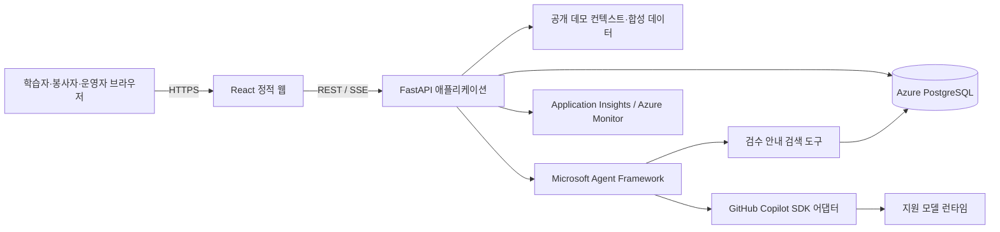

# 청도 디지털 생활도우미 — 기술 설계 문서

| 항목 | 내용 |
|---|---|
| 문서 상태 | 권장 설계안 — 구현 전 팀 확인 완료 |
| 기준 PRD | [`PRD.md`](PRD.md) |
| 제품 | 청도 디지털 생활도우미 |
| 범위 | 어르신 디지털 과제 학습, 개인 전용 진척 배지, AI 생활 코치, 동네별 학습모임·공동 진척, 익명 집계 지표 |

> 이 문서는 PRD를 구현 설계로 옮긴 제안이다. 저장소에는 애플리케이션 코드가 없으므로 아래 기술은 아직 구현되거나 운영 배포된 것으로 간주하지 않는다. 심사용 배포는 로그인·회원가입·초대·별도 권한 없이 첫 화면에서 바로 사용할 수 있는 공개 데모로 운영한다. Copilot SDK/Agent Framework 버전·런타임 호환성과 Azure 배포 구성은 팀이 첫 구현 전에 검증하고 확정해야 한다.

## 1. 설계 목표와 원칙

- PRD의 Must 흐름인 과제 시작·완료, 근거가 표시된 AI 코치, 동네 모임 질문·답변·도움 요청·해결, 신고/숨김을 end-to-end로 구현한다.
- 심사자가 로그인·회원가입·초대·역할 승인 없이 모든 핵심 화면과 기능을 체험할 수 있도록 공개 데모 워크스페이스를 제공한다. 역할 선택은 화면의 관점/시연 맥락만 바꾸며 API 접근을 제한하지 않는다.
- 공개 데모는 합성 데이터만 사용한다. 실제 사용자·개인정보를 담는 운영 모드와 데모 모드는 데이터베이스/환경을 분리한다. 데모 모드는 공개 환경에서 개인 또는 민감정보를 저장하지 않는다.
- AI는 검색 도구를 통해 검수된 안내 자료를 사용하되 실제 메시지 발송, 예약, 결제, 커뮤니티 게시 등 외부 쓰기 작업을 갖지 않는다.
- Azure 구성은 웹/API, 영속 저장소, 관찰성에 필요한 최소 범위로 제한한다.
- 데모 상호작용에는 비밀번호, 인증번호, 금융/건강정보, 연락처, 정확한 위치 등 실사용자 개인정보를 입력하지 않도록 안내한다. 이 앱은 이를 수집할 필요가 없다.
- 모바일 우선, 쉬운 한국어, 큰 터치 대상과 장애/실패 시 회복 흐름을 기본 설계에 포함한다.

## 2. 권장 기술 구성

| 계층 | 권장안 | 선택 근거 및 미확정 사항 |
|---|---|---|
| 웹 클라이언트 | React + TypeScript + Vite | 모바일 우선 UI와 정적 빌드, 단계 학습/커뮤니티 화면에 충분하다. 디자인 시스템과 상태 라이브러리는 필요가 입증될 때 추가한다. |
| API/애플리케이션 | Python 3.12 + FastAPI | 비동기 API와 SSE 스트리밍에 적합하고, Python 기반 Agent Framework와 한 런타임에서 경계를 나눌 수 있다. |
| 에이전트 | Microsoft Agent Framework (Python) | 대화 흐름, 안내 검색 도구 호출과 상태 처리를 오케스트레이션한다. 프리뷰/정식 상태와 배포 요구사항을 구현 시점에 확인한다. |
| 모델 연결 | GitHub Copilot SDK (지원되는 Python 패키지/런타임) | 모델 연결 및 스트리밍 어댑터로 사용한다. SDK 버전, Copilot CLI 런타임 의존성, Azure Container Apps에서의 지원 가능한 인증/운영 방식을 먼저 spike로 검증한다. |
| 영속 데이터 | Azure Database for PostgreSQL Flexible Server | 사용자/모임/게시물/진행 기록을 관계형 제약 및 트랜잭션으로 일관되게 관리한다. 팀의 Azure 구독·비용·배포 제약에 따라 대체 여부를 결정한다. |
| 배포 | Azure Container Apps의 단일 웹/API 컨테이너 | 같은 오리진에서 Vite 정적 산출물과 API를 제공해 배포 및 CORS 복잡도를 줄인다. SSE 스트리밍과 앱 로그를 운영 환경에서 확인한다. |
| 관찰성 | Application Insights 및 Azure Monitor 연동 | 요청, 오류, 지연, 외부 모델 호출 상태를 확인한다. 프롬프트/질문 원문은 기본적으로 수집하지 않는다. |

### 기술 결정 게이트

Copilot SDK를 실행하는 런타임/CLI와 인증 방식이 Container Apps에서 지원 가능한지 별도 최소 spike로 검증한다. 검증 항목은 설치 가능한 런타임, 비대화형 시작, 인증 주체/토큰 전달, 네트워크 요구, 재시작·동시 요청·스트리밍 동작이다. 로컬 개발에서 통하는 인증이 배포 환경에서도 통한다고 가정하지 않는다. 이 조건이 충족되지 않으면 배포 구성을 다시 선택하고, 평가 필수 기술을 임의의 다른 SDK로 대체하지 않는다.

프론트엔드와 API는 앱 내 모듈 경계를 유지하고 처음부터 마이크로서비스로 나누지 않는다. 검수 안내 검색은 MVP에서 PostgreSQL의 단순 전문 검색/태그 검색을 우선 사용하고, 별도 벡터 검색 서비스는 품질과 데이터 규모가 요구할 때에만 고려한다.

## 3. 논리 아키텍처



애플리케이션은 다음 모듈을 한 배포 단위에 둔다.

- `web`: 홈, 학습, 코치, 모임, 운영자 화면
- `api`: 요청 검증, 애플리케이션 서비스, 데이터 접근, SSE 스트림
- `demo`: 공개 접근, 익명 방문자 세션/페르소나 및 격리된 합성 데모 워크스페이스
- `coach`: Agent Framework 오케스트레이션, 검색 도구, SDK 어댑터, 출력 검증
- `content`: 관리자/팀이 작성하고 검수한 과제 및 안내 자료
- `progress`: 개인 완료 상태/배지 계산과 모임 공동 진척 집계
- `telemetry`: 요청 ID, 오류/지연 기록, 민감정보 제거

모델 호출은 서버에서만 실행한다. 브라우저에 모델 키, SDK 자격 증명, 검색 인덱스 접근 권한을 노출하지 않는다. 공개 심사용 화면에는 로그인·회원가입·초대 코드·승인 대기 또는 역할별 접근 거부가 없어야 한다.

## 4. 주요 데이터 모델

모든 기본 키는 UUID를 권장한다. 생성/수정 시각은 UTC로 저장하고 화면에서 한국 시간으로 표시한다. 실제 DB 마이그레이션과 필드 필수성은 구현 시 확정한다.

| 엔티티 | 주요 필드 | 관계/제약 |
|---|---|---|
| `demo_visitors` | `visitor_id`, `persona`, `created_at`, `last_seen_at` | 로그인 계정이 아닌 익명 방문자 식별자. 서버가 서명된 익명 연속성 쿠키로 발급하지만 접근 허가/권한 증명으로 사용하지 않는다. 페르소나는 `learner`, `volunteer`, `moderator` 중 자유롭게 바꿀 수 있으며 기능 접근은 제한하지 않는다. |
| `groups` | `id`, `name`, `region_code`, `status` | 동네 학습모임. 지역은 필요한 최소 단위만 저장. |
| `group_memberships` | `group_id`, `visitor_id`, `persona`, `joined_at` | 합성 데모에서 모임 활동을 시연하기 위한 attribution 데이터이며 인증·멤버십 권한 검사 기준이 아니다. 모임 선택/참여는 누구나 즉시 가능하고 게시물과 모임은 누구나 읽고 작성할 수 있다. |
| `learning_tasks` | `id`, `title`, `summary`, `category`, `status`, `reviewed_at` | 검수된 학습 과제만 공개. |
| `task_steps` | `id`, `task_id`, `step_number`, `instruction`, `image_ref`, `reviewed_at` | `(task_id, step_number)` unique. 민감한 인증/결제 정보 입력을 요구하지 않음. |
| `learning_progress` | `id`, `visitor_id`, `task_id`, `started_at`, `completed_at`, `self_rating` | 익명 방문자별 이어하기와 완료 기록. `(visitor_id, task_id)` unique 권장. 로그인 계정이 아니며 타 사용자 개인정보를 보관하지 않는다. |
| `user_preferences` | `visitor_id`, `show_progress`, `updated_at` | 개인 진척 표시 설정. `show_progress` 기본값은 true이며, 끄더라도 학습 기록·과제·도움 요청은 유지된다. |
| `badge_definitions` | `id`, `code`, `title`, `criteria_type`, `criteria_value`, `criteria_version`, `active` | 예: 첫 과제 완료(`distinct_completed_tasks >= 1`), 서로 다른 과제 3개 완료(`>= 3`). 연속 접속, 시간 제한, 실패, 자신감 응답은 조건으로 사용하지 않는다. |
| `user_badges` | `visitor_id`, `badge_id`, `earned_at`, `criteria_version` | `(visitor_id, badge_id)` unique. 서로 다른 완료 과제 ID에서만 산정한다. 익명 방문자 기준 진척이며 보안상 개인 데이터로 취급하지 않는다. |
| `guide_documents` | `id`, `title`, `body`, `source_name`, `source_url`, `review_status`, `reviewed_at`, `updated_at` | 검색 대상은 검수 완료 문서만. |
| `posts` | `id`, `group_id`, `author_visitor_id`, `author_persona`, `type`, `title`, `body`, `status`, `resolved_at`, `created_at`, `updated_at` | `type`: `question`/`help`; `status`: `open`/`resolved`/`hidden`. 공개 합성 데모 게시물이며 누구나 조회 가능. |
| `answers` | `id`, `post_id`, `author_visitor_id`, `author_persona`, `body`, `created_at`, `status` | 공개 합성 데모 콘텐츠. 페르소나는 화면 표시용이며 쓰기/숨김 권한을 통제하지 않음. |
| `reports` | `id`, `post_id`, `reporter_visitor_id`, `reason_code`, `status`, `created_at` | 합성 데모 신고. 신고 목록/운영 흐름은 로그인 없이 누구나 시연 가능. |

게시물 본문과 AI 질문은 민감한 내용이 들어올 수 있는 비정형 자유 텍스트다. 공개 데모에서는 가상 예시만 입력하도록 명시하고, 실제 개인정보를 입력하지 않도록 작성 화면에서 경고한다. MVP에서는 필요한 경우 외에는 복제·색인하지 않고, 분석 로그나 지표 테이블에 원문을 넣지 않는다. 데모 게시물과 답변은 모든 방문자에게 공개된다.

익명 방문자 ID는 로그인/회원가입 없이 첫 방문 시 발급하고 기능 접근을 제한하지 않는 연속성·중복 집계용 식별자다. 페르소나 전환은 언제든 허용한다. 합성 데모이므로 진척이나 게시물은 공개될 수 있고, 개인 배지는 타 방문자와 공유하지 않는 UI 관례일 뿐 보안/개인정보 보호 경계가 아니다. 개인 배지는 `user_badges`의 고유 제약으로 중복 발급을 막고, 완료 기록을 기준으로 재계산할 수 있게 한다. 진척 UI를 숨기는 설정은 표현 설정일 뿐 기록이나 집계의 삭제/초기화를 의미하지 않는다.

### 주요 인덱스

- `group_memberships(visitor_id, group_id)`
- `posts(group_id, status, created_at DESC)`
- `answers(post_id, created_at)`
- `learning_progress(visitor_id, task_id)`
- `user_badges(visitor_id, badge_id)` unique
- `guide_documents(review_status, updated_at)`

초기 데이터는 가상 그룹·검수된 안내 자료와 시연 게시물만 포함한다. 심사 배포는 운영 데이터와 분리된 합성 전용 환경이어야 한다. 공개 데모의 변경 가능한 데이터는 재설정 가능한 시연 데이터로 취급하며, 실제 사용자 파일럿 이전에는 별도 서비스/환경, 사용자 동의, 보관 기간, 삭제 규칙을 확정한다.

## 5. API 설계

API는 `/api/v1` 아래 공개 JSON REST를 사용한다. 코치 응답만 `text/event-stream` SSE로 전달한다. 심사 환경의 모든 핵심 API에는 로그인, 계정, 초대, 모임 가입 승인, 역할별 권한 검사를 요구하지 않는다. 익명 방문자 쿠키는 선택적인 진행 연속성과 합성 데이터 귀속에만 사용하며 쿠키가 없어도 기본 데이터/기능을 바로 이용할 수 있어야 한다. 요청/응답 DTO는 ORM 엔티티와 분리하고 모든 입력을 서버에서 검증한다.

| 메서드·경로 | 기능 | 심사용 접근 정책 |
|---|---|---|
| `GET /api/v1/demo` | 익명 데모 컨텍스트·선택된 화면 페르소나 조회 | 공개; 로그인 불필요 |
| `POST /api/v1/demo/reset` | 합성 시연 데이터를 seed 상태로 복구 | 공개; 데모 전용 데이터만 변경 |
| `PUT /api/v1/demo/persona` | 학습자/봉사자/운영자 관점 전환 | 공개; 페르소나는 기능 권한이 아님 |
| `GET /api/v1/tasks` | 공개·검수 완료 과제 목록 | 공개 |
| `GET /api/v1/tasks/{taskId}` | 과제와 단계 조회 | 공개 |
| `PUT /api/v1/tasks/{taskId}/progress` | 시작/단계 진행/완료 기록 upsert | 공개; 익명 방문자에 귀속 |
| `GET /api/v1/demo/progress` | 현재 익명 데모 컨텍스트의 과제 진행 및 배지 | 공개 |
| `PATCH /api/v1/demo/preferences` | 개인 진척 안내/배지 표시 on/off 변경 | 공개 |
| `POST /api/v1/coach/sessions` | 코치 질의와 선택적 과제 컨텍스트를 SSE로 응답 | 공개; 서비스 자격 증명은 서버에만 보관, 요청 제한 적용 |
| `POST /api/v1/groups/{groupId}/posts` | 질문 또는 도움 요청 작성 | 공개; 합성 데모 콘텐츠임을 표시 |
| `GET /api/v1/groups/{groupId}/posts` | 모임 게시물 목록 | 공개 |
| `GET /api/v1/posts/{postId}` | 게시물과 답변 조회 | 공개 |
| `POST /api/v1/posts/{postId}/answers` | 게시물 답변 | 공개; 합성 데모 콘텐츠임을 표시 |
| `PATCH /api/v1/posts/{postId}` | 해결/재개 상태 변경 | 공개 데모에서 로그인/작성자 권한 검사 없이 시연 가능 |
| `POST /api/v1/posts/{postId}/reports` | 게시물 신고 | 공개; 반복/남용 방지 요청 제한 적용 |
| `GET /api/v1/moderation/reports` | 신고 목록 조회 | 공개 데모에서 운영자 흐름 시연 가능 |
| `POST /api/v1/moderation/posts/{postId}/hide` | 게시물 숨김 처리 | 공개 데모에서 운영자 흐름 시연 가능; 운영 데이터에 연결 금지 |
| `GET /api/v1/metrics/summary` | 합성 데모의 비식별 집계 지표 | 공개; 개인 정보/원문 미포함 |
| `GET /api/v1/groups/{groupId}/progress` | 모임의 익명 공동 진척 및 사전 안내된 이정표 조회 | 공개 |

### 오류 형식

JSON 오류는 다음 공통 구조를 사용한다. 내부 예외, SQL, 프롬프트, 토큰 및 stack trace는 클라이언트에 노출하지 않는다.

```json
{
  "error": {
    "code": "invalid_request",
    "message": "입력 내용을 확인하고 다시 시도해 주세요.",
    "requestId": "server-generated-id"
  }
}
```

- `400`: 형식/필드 검증 오류; 필드별 쉬운 안내 문구를 제공한다.
- `404`: 존재하지 않는 리소스.
- `409`: 이미 완료된 상태 변경 등 충돌.
- `429`: 익명 세션/요청 IP/모델 공급자별 요청 제한.
- `502`/`503`: 검색 도구 또는 모델 서비스 실패. 사용자에게 재시도/사람 도움 요청을 제공한다.

심사 배포 API는 인증 부재를 이유로 핵심 경로에서 `401` 또는 `403`을 반환해서는 안 된다. 서비스 대 서버 Copilot SDK 인증은 모델 연결에만 쓰이며 앱 방문자 로그인을 요구하는 수단이 아니다.

### 게시물 상태 전이

```text
open --(공개 데모 방문자의 해결 선택)--> resolved
open --(공개 데모 방문자의 숨김 시연)--> hidden
resolved --(공개 데모 방문자의 재개 선택)--> open
```

모든 커뮤니티/운영 API는 공개 데모 데이터에 대해 로그인 없이 동작한다. 운영자 페르소나는 데모 UI에서 처리 흐름을 이해하기 위한 표시일 뿐 숨김 API에 대한 별도 권한이 아니다. 공개 데모에서 누구나 숨김 처리를 시연할 수 있으므로 실제 사용자 데이터나 운영 커뮤니티와 데모 환경을 절대 공유하지 않는다. 일반 목록·집계 API는 숨김 본문/답변을 제외한다. 운영 작업은 익명 방문자 식별자와 시각을 합성 데모 감사 이벤트로 기록한다.

이 공개 접근 정책은 심사 에이전트가 별도 인증/권한 설정 없이 제품 기능을 평가해야 한다는 배포 요구를 위해 합성 데모에 한정해 PRD의 일반 모임 멤버십/운영자 접근 규칙을 구체화한 것이다. 실사용 데이터와 공개 심사 데모를 같은 환경에서 운용하지 않는다.

### 진척과 공동 이정표 산정

- **개인 배지:** 현재 익명 데모 컨텍스트에 귀속된 완료 기록 중 서로 다른 `task_id`의 수로 결정한다. 같은 과제 재시도/중복 API 요청은 고유 `(visitor_id, task_id)` 진행 기록과 `(visitor_id, badge_id)` 제약으로 추가 진척을 만들지 않는다. 배지 조건은 서버 정의(`badge_definitions`)만 사용하고 공개 프로필·순위·보상 API는 없다.
- **진척 표시 설정:** `show_progress=false`이면 현재 데모 컨텍스트의 화면에서 배지/진척 장식을 감추되 단계 안내, 이어하기, 완료 상태, 커뮤니티 접근을 제한하지 않는다. 서버는 설정만 저장하고 학습 데이터는 유지한다. 익명 컨텍스트는 본인 확인/비밀이 아니므로 이 동작은 개인정보 접근 제어를 제공하지 않는다.
- **모임 공동 진척:** 해결된 도움 요청(`type=help`, `status=resolved`)만 집계한다. 신고로 숨김된 게시물, 질문 유형 게시물, 미해결 게시물은 제외한다. 공동 해결 건수는 적격 게시물 ID의 `COUNT(DISTINCT post_id)`로 계산한다.
- 모임 공동 진척/이정표를 노출할 때는 적격 게시물에 참여한 작성자와 유효 답변 작성자로 식별된 서로 다른 익명 방문자 3명 이상이어야 한다. 이 기준은 모임 단위의 방문자 집합에 적용한다. 익명 ID는 조작/초기화될 수 있으므로 이 수치는 데모 시각화용이며 실제 참여 인원이나 성과 측정에 사용하지 않는다. 개인별 기여 내역은 제공하지 않는다.
- 같은 게시물의 반복 해결/재개 조작은 현재 상태 기준으로 최대 1건만 기여한다. 미해결로 되돌리거나 숨김 처리하면 현재 집계에서 제외되고, 다시 해결되면 다시 최대 1건으로 반영된다.
- 미리 정의된 모임 이정표(예: 3건, 10건)는 적격 게시물 수로부터 계산한다. MVP에서는 버전 관리되는 설정값으로 두고 운영자가 기준을 사전에 안내한다. 모임끼리 비교/순위를 매기지 않고, 개인별 기여자 목록·점수·배지를 노출하지 않는다.
- 매 조회 시 실시간으로 집계하거나 캐시를 쓰더라도, 원본 상태를 기준으로 재계산 가능한 derived data로 취급한다. 캐시 키는 모임과 집계 버전을 포함하고, 해결/재개/숨김/답변 상태 변경 시 무효화한다. 집계 캐시를 권위 있는 진척 원장으로 사용하지 않는다.
- 모임 공동 진척은 적격 게시물 전체의 익명 방문자 집합이 3명 이상일 때만 공개 데모 화면에 표시한다. 조건 미달이면 공동 진척 숫자와 이정표를 숨겨 소규모 그룹의 참여 관계를 추론하게 하지 않는다.
- 완료 요건은 현재 익명 컨텍스트에서 `learning_progress.completed_at IS NOT NULL`인 서로 다른 과제 수다. 재학습·재시도·동일 완료 API 재전송은 `DISTINCT task_id` 계산과 unique 제약으로 추가 진척을 주지 않는다. 첫 과제 및 3개 과제 배지는 그 컨텍스트의 데모 화면에만 표시하며, 계정 기반 본인 확인을 제공하지 않는다. 자신감 응답은 배지 산정에 사용하지 않는다.
- 공동 진척의 답변 참여자는 게시물의 유효한 답변 작성자로 계산한다. 모임 참여자 수는 적격 도움 요청에 작성자 또는 답변자로 참여한 서로 다른 익명 visitor ID 수이며, 화면에는 방문자 ID/명단을 내보내지 않는다.
- 그룹 집계는 게시물의 현재 상태에서 파생한다. 답변 삭제/숨김, 게시물 해결/재개, 게시물 숨김 시 동일 트랜잭션 이후 해당 집계를 다시 계산하거나 캐시를 무효화해 오래된 이정표를 노출하지 않는다.

## 6. AI 코치와 스트리밍 흐름

1. 브라우저는 민감정보를 입력하지 말라는 안내를 보여주고 `POST /coach/sessions`에 질문과 선택적 `taskId`를 보낸다.
2. API는 방문자 로그인을 요구하지 않고 길이/형식 검증과 공개 요청 제한을 적용한 뒤 새 `requestId`를 만든다. 익명 방문자 ID가 없으면 비개인 식별자를 생성해 진행 연속성에만 사용한다.
3. Agent Framework는 고정된 시스템 정책으로 대화를 오케스트레이션한다. 질문에 필요한 정보가 부족하면 검색·응답 전에 짧은 확인 질문을 반환한다.
4. 안내 검색 도구는 `review_status = approved`인 `guide_documents`만 검색한다. 도구 출력은 인용할 자료 ID·제목·출처와 짧은 근거 텍스트로 제한한다.
5. 에이전트는 Copilot SDK 어댑터를 통해 모델에 요청하고, 검색 근거가 있을 때만 단계형 안내를 생성한다. 모델 출력에 도구 호출·게시·외부 side effect 권한을 주지 않는다.
6. API는 다음 이벤트를 SSE로 전달한다: `status`, `token`, `citation`, `clarification`, `done`, `error`. 클라이언트는 `requestId`와 상태를 이용해 재시도/중단 UI를 관리한다.
7. 근거 없음이면 일반 절차를 지어내지 않고 근거 부족 상태 및 동네 모임 도움 요청 링크를 전달한다. 질문/답변은 사용자가 확인하기 전 커뮤니티에 저장하지 않는다.
8. 브라우저가 연결을 종료하면 가능한 SDK/런타임 취소 메커니즘으로 모델 처리를 중단한다. 취소 지원 여부는 SDK spike에서 확인하고, 지원되지 않으면 유휴 작업 종료 한도를 둔다.

SSE 완료 데이터 예시:

```json
{
  "type": "done",
  "requestId": "server-generated-id",
  "answerType": "grounded",
  "citations": [
    {
      "documentId": "uuid",
      "title": "사진 보내기 안내",
      "sourceName": "검수된 디지털 과제 자료"
    }
  ],
  "humanHelpAvailable": true
}
```

실제 SDK 이벤트와 Agent Framework 이벤트의 이름/스트림 형식은 버전별로 달라질 수 있으므로 API는 안정된 앱 전용 SSE 이벤트로 변환한다. 모델 원문 토큰 외에 내부 reasoning, 비밀 값, 사용자 원문 로그를 내보내지 않는다.

### 프롬프트 인젝션 및 출력 안전

- 사용자 질문과 검색 문서는 데이터로 구분하고 명령으로 신뢰하지 않는다.
- 검색 도구는 읽기 전용이며 인가된 안내 자료만 반환한다.
- 모델 출력은 신뢰하지 않는 데이터로 처리한다. HTML은 렌더링 전에 escape하고, 링크는 허용된 URL 정책을 적용한다.
- 외부 행동이나 게시를 유발하는 도구는 에이전트에 등록하지 않는다.
- 안내 문서 수정·승인은 에이전트와 분리된 검수 경로로만 수행한다.

## 7. 무인증 공개 접근, 데모 안전, 개인정보

### 심사 앱 접근 정책

- 심사자가 공개 URL을 열면 홈과 대표 기능을 곧바로 사용한다. 로그인/회원가입 화면, 초대 코드, 가입 승인, 약관 동의를 빙자한 진입 차단, 역할별 API 거부를 두지 않는다.
- 학습자·봉사자·운영자 페르소나는 화면 예시와 게시물 표시에만 사용한다. 누구든 언제든 바꿀 수 있고 페르소나/쿠키 값을 위조해도 접근 가능한 기능의 범위는 달라지지 않는다.
- 과제 조회·진행·AI 코치·게시물/답변 작성·해결 상태·신고/숨김 시연·집계·공동 진척을 공개 API로 제공한다. 핵심 흐름에서 `401 Unauthorized`나 `403 Forbidden`을 요구하지 않는다.
- 익명 방문자 ID는 선택적 연속성/중복 방지 식별자일 뿐 인증 토큰이나 비밀로 취급하지 않는다. 쿠키 거부/삭제/새 브라우저에서도 임시 세션으로 핵심 기능 사용을 막지 않는다. ID는 과제 진행, 배지, 집계 귀속 용도로만 쓰며 이름·이메일·전화번호와 연결하지 않는다.
- 앱 서비스가 AI 모델을 부르는 서버 측 Copilot SDK 자격 증명은 방문자 인증과 별개다. 비밀 값은 브라우저로 전달하지 않고 서버 환경에서 보호한다.
- 보고/숨김/해결 상태 변경까지 공개로 노출되는 구성은 **합성 데이터만 사용하는 심사 데모에 한정**한다. 이 배포를 실제 군민 데이터나 운영 커뮤니티와 연결하지 않는다. 실사용 파일럿은 별도 의사결정으로 인증·운영 권한 및 데이터 정책을 새로 설계한다.

### 공개 데모 남용 방지

- 게시물/답변/질문 길이, 요청 본문 크기, 페이지 크기, AI 동시 실행 및 분당 요청에 상한을 둔다. 제한은 봇·비용 남용 방지용이며 사용자 권한이나 가입 요구로 쓰지 않는다.
- 공개 쓰기는 합성 데모 환경에만 기록한다. 시연 데이터 재설정은 seed snapshot에서 복구할 수 있어야 하며, 재설정 경로는 심사자가 접근 가능한 UI에 제공하되 애플리케이션을 중단시키지 않도록 한다.
- 운영자 숨김 등 가역적 변경은 데모 전용으로만 허용한다. 실제 서비스 데이터 삭제/관리 권한을 이 공개 엔드포인트에 연결하지 않는다.
- 같은 오리진 API만 허용하고 CORS를 와일드카드로 열지 않는다. CSRF 관점에서 상태 변경 요청에 Origin 검증을 적용하되, 쿠키나 로그인 없는 요청의 정상 이용을 차단하지 않는다.

### 데이터 보호

- AI/커뮤니티 입력에서 실사용 비밀번호·인증번호·금융/건강 정보·연락처를 넣지 않도록 안내한다. 심사 데모에는 합성 예시만 사용한다. 안내 문구를 민감정보의 안전한 수집 동의로 간주하지 않는다.
- 정확한 현재 위치를 수집하지 않는다. 과제/모임에는 필요한 읍·면 수준 정보만 저장한다.
- HTTPS 전송을 적용하고, 저장 데이터·백업 암호화는 Azure 관리형 보호 기능을 사용한다.
- 로그에는 `requestId`, 익명 방문자 ID(필요 최소), endpoint, status, latency, 에이전트 단계/도구 성공 여부를 남긴다. 질문/답변 본문, 인증 헤더, 쿠키/세션 값, 비밀 값은 기본 기록하지 않는다.
- 데이터는 가상 데모 콘텐츠임을 UI와 입력 영역에서 분명히 표시한다. 심사 배포에서는 이름·이메일·전화번호·정확한 위치를 요구하거나 수집하지 않는다.
- 공개 공동 집계의 방문자 수는 쿠키 초기화/변조/복수 방문으로 부풀릴 수 있으므로 심사 데모용 지표일 뿐 실제 주민의 참여/생산성 근거로 주장하지 않는다.
- 진척 UI의 `show_progress=false`는 화면 장식만 감춘다. 데이터 접근 보안 수단으로 간주하지 않는다. 데모 데이터와 배지는 모두 합성/비식별이며 URL이나 임의 visitor ID로 조회될 수 있으므로 민감한 개인 데이터를 절대 포함하지 않는다.

## 8. Azure 배포 및 운영

### 권장 배치

- Azure Container Apps: React 정적 산출물과 FastAPI를 제공하는 컨테이너 앱 한 개. HTTPS ingress를 사용하고 심사 URL은 공개로 설정한다(인증 provider, 로그인 proxy, invite wall 사용 금지). 직접 URL 진입과 새 브라우저 세션에서 첫 화면이 열리는지 확인하며 SSE가 버퍼링 없이 동작하는지도 검증한다.
- Azure Database for PostgreSQL Flexible Server: 앱 데이터와 과제/안내 자료. 가능한 경우 사설 네트워크 연결 및 최소 권한 DB 사용자 사용.
- Application Insights/Azure Monitor: 요청/예외/지연/의존성 상태 관찰.
- Azure Container Apps secrets 또는 Key Vault 연동: DB 암호, 모델/SDK 자격 증명 등 비밀 값 주입. 비밀 값은 이미지, Git, 빌드 로그에 넣지 않는다.

서비스 계정과 Copilot 런타임 인증을 지원하는 Azure 권장 패턴이 SDK에서 가능한지는 사전 spike 결과에 따라 결정한다. 장기 개인 토큰을 이미지나 저장소에 박아 넣는 방식은 배포 허용 구성으로 간주하지 않는다.

### 배포 절차 제안

1. 환경 변수/secret 목록과 포트, health endpoint를 코드에 선언한다.
2. CI에서 lint/type check, 테스트, 이미지 빌드 및 취약 dependency 점검을 수행한다.
3. 이미지 registry에 버전 태그를 게시하고 Container Apps의 테스트 환경에 배포한다.
4. DB 마이그레이션은 호환성 있는 순서로 수행하고 health/readiness 확인 후 트래픽을 전환한다.
5. 시연 전 외부 네트워크에서 로그인 없는 첫 진입, 과제 조회/완료, 코치 SSE, 게시물/답변, 해결/신고/숨김, 모임 진척과 지표 조회를 실제 공개 URL로 smoke test한다.
6. 배포 ID/버전과 운영 상태를 기록하고 이전 이미지로 되돌릴 절차를 준비한다.

인프라 코드 도구(Terraform/Bicep)와 GitHub Actions 사용은 구독 권한 및 팀 숙련도 확인 후 선택한다. TRD만으로 해당 자원이 이미 준비됐다고 간주하지 않는다.

### 관찰성 및 신뢰성

- `/health/live`는 프로세스 생존, `/health/ready`는 앱 설정과 필수 DB 연결 준비를 구분한다. readiness 응답에는 비밀이나 연결 문자열을 포함하지 않는다.
- 메트릭: HTTP 오류율/지연, DB 실패/지연, AI 요청 지연/실패/근거 없음 비율, 중단 수, SSE 완료/끊김.
- alert는 데모·파일럿에 필요한 최소 오류만 설정하고 불필요한 개인정보를 알림에 넣지 않는다.
- 외부 모델 호출은 제한 시간과 동시성/요청 제한을 둔다. 자동 재시도는 중복 비용·중복 응답을 만들 수 있으므로 안전한 오류에만 제한한다.
- DB 백업/복구 설정과 보관 기간은 실제 환경의 비용 및 중요도에 따라 확정한다.

## 9. 접근성 및 성능

- 모바일 우선 반응형 레이아웃과 확대 가능한 글자 크기를 지원한다. 브라우저 줌을 막지 않는다.
- WCAG 2.2 AA를 참고해 대비, 키보드 포커스, 시맨틱 헤딩/버튼, 입력 레이블, 오류 안내를 점검한다.
- 터치 요소는 충분한 크기와 간격을 제공하고 상태는 색상만으로 전달하지 않는다.
- 음성 읽기는 브라우저 TTS 지원 여부를 감지하고, 미지원 시에도 같은 안내를 읽을 수 있는 텍스트를 항상 제공한다. 자동 재생을 하지 않고 사용자 조작으로 시작/중지한다.
- 코치 스트리밍은 문장/단계 단위로 화면 낭독기가 따라갈 수 있도록 하며 토큰마다 과도한 live announcement를 발생시키지 않는다.
- 목록 API는 페이지네이션을 적용한다. 장시간 AI 요청은 상태와 중단/재시도 경로를 제공하고 요청별 시간 제한을 둔다.

## 10. 테스트 전략과 수용 기준 연결

| 영역 | 최소 검증 |
|---|---|
| 무인증 심사 접근 | 깨끗한 시크릿 브라우저/쿠키 차단 상태로 배포 URL 진입 후 로그인·회원가입·초대·승인 없이 모든 핵심 화면을 이용하고 learner/volunteer/moderator 페르소나 및 운영자 흐름까지 완료 |
| 과제 학습 | 목록·단계 탐색·이전/다음·진행 저장·완료/이어하기의 API 및 UI 테스트 |
| 개인 진척 배지 | 첫 과제/서로 다른 과제 3개 조건, 재시도·중복 요청, 쿠키 미설정 상태 기본 이용, 표시 설정 off 후에도 학습 흐름 유지 테스트 |
| AI 검색/에이전트 | 검수 자료만 검색되는지, 자료 없음일 때 답을 지어내지 않는지, 도구 실패/모델 실패/취소/SSE 종료를 통합 테스트 |
| 커뮤니티 | 모임 가입 절차 없이 조회/작성, 답변·해결 상태 전이, 공개 신고·운영자 숨김 흐름, 숨김 본문 미노출 테스트 |
| 공동 진척 | 작성자+답변자 중 서로 다른 익명 visitor ID 3개 이상 조건, 해결된 도움 요청만 포함, 질문/숨김/미해결 제외, 게시물 1회 집계, 재개 시 제거·재해결 시 중복 없음, 3개 미만 표시 억제, ID 변조 가능성이 있어 성과 측정에 쓰지 않는 안내, 개인 기여/모임 순위 미노출 테스트 |
| 집계 | 완료율·완료 시간·해결률 분모/분자, 개인 배지/선호 설정이 팀 지표에 섞이지 않는지, 숨김 글 처리와 개인 식별 필드 미노출을 검증 |
| 공개 데모 안전 | 공개 API의 payload/페이지/AI 동시성·요청 제한, 데모 seed 재설정, 운영 데이터와 완전 분리, CORS/Origin 및 HTML 출력 안전 검증 |
| 개인정보 | 로그 및 오류 응답에 질문 원문/쿠키/토큰/비밀이 포함되지 않는지 검사; 공개 데모가 개인 정보를 요구하지 않음을 확인 |
| UX/접근성 | 모바일/데스크톱 주요 흐름, 키보드, 포커스, 대비, 텍스트 확대, TTS 미지원 대체 동작 수동 점검 |
| Azure 배포 | readiness, DB 연결, SSE 스트리밍, 모델/도구 오류 로그 및 secret 주입을 테스트 환경에서 smoke test |

### PRD Must 요구사항 추적

| PRD 항목 | TRD 대응 |
|---|---|
| FR-01 홈·과제 찾기 | `learning_tasks`와 과제 목록 API, 웹 클라이언트 및 빈/오류 상태 |
| FR-02 단계별 학습 | `task_steps`, `learning_progress`, 진행 API, 접근성 요구사항 |
| FR-03 AI 생활 코치 | Agent Framework + Copilot SDK 어댑터, 검수 문서 도구, SSE·citation·fallback |
| FR-04 모임 커뮤니티 | 공개 `groups/posts/answers/reports` API, 가입 절차 없는 읽기/쓰기, 상태 전이 |
| FR-05 지원자·운영자·공동 진척 | 미해결/신고 목록과 공개 숨김 시연 API, 3개 이상 익명 ID가 참여한 적격 해결 도움 요청 기반 합성 모임 집계/이정표 |
| FR-06 학습 지표·개인 배지 | 익명 데모 컨텍스트 기반 진행/배지와 표시 설정, 고유 과제 완료 기준, 합성·비식별 운영 지표 |
| Azure·보안·신뢰 | 배포 구조, secret, 관찰성, 오류 처리, 프롬프트/출력 경계 |

### 심사 접근 조건 출시 체크리스트

- 외부 심사자는 앱 URL만으로 즉시 시작할 수 있다. 가입/로그인/초대/승인 또는 권한 오류가 주요 기능보다 먼저 나오지 않는다.
- 새 브라우저/시크릿 창 및 쿠키가 차단된 상태에서도 홈·과제·AI 코치·커뮤니티·집계의 기본 흐름이 동작한다. 진행 유지가 불가능하면 일시 세션으로 체험을 이어가며 접근 자체는 막지 않는다.
- 역할 전환은 언제든지 가능하고 권한 상승/감소가 아니라 화면상 persona 라벨만 바꾼다. 평가자가 질문/답변을 작성하고, 해결 표시, 신고와 숨김 처리를 모두 로그인 없이 체험할 수 있다.
- URL을 직접 열어도 SPA/API가 정상 로드되고, 스트리밍 및 읽기/쓰기 요청이 공개 배포 설정과 충돌하지 않는다.
- 데모에 표시되는 사용자/커뮤니티 콘텐츠와 지표는 합성 또는 익명 시연 자료다. 실제 이용자 데이터, AI/모델 비밀, 내부 운영 도구는 공개 범위에 포함하지 않는다.
- 외부 공개 전에 서로 다른 네트워크에서 반복 검증하고, 데모 기능이 앱 게이트웨이나 identity middleware에서 잠겨 있지 않은지 확인한다.

## 11. 구현 전 확인이 필요한 결정

1. Copilot SDK 패키지와 Agent Framework 버전의 상호 운용성 및 Azure 비대화형 인증/실행 지원.
2. Azure 구독/조직 정책, PostgreSQL 및 Container Apps 사용 가능 여부와 비용 한도.
3. 심사 배포의 공개 접근 및 합성 데모 데이터 reset/retention 방식.
4. 읍·면/모임의 초기 데이터 출처와 운영자 승인 절차.
5. 과제 및 생활 안내 자료의 작성·검수 책임자와 출처 사용 권한.
6. 실제 파일럿 시 질문 원문·진행 기록의 동의, 보관, 삭제 정책.

위 결정 중 특히 SDK 서비스 자격 증명/런타임과 공개 배포 SSE 동작은 에이전트 구현을 넓히기 전에 spike로 확인한다. 방문자 로그인은 심사 배포에서 사용하지 않는다. 결과와 버전을 TRD에 갱신하고, 팀이 선택한 최종 사항만 확정 결정으로 승격한다.
